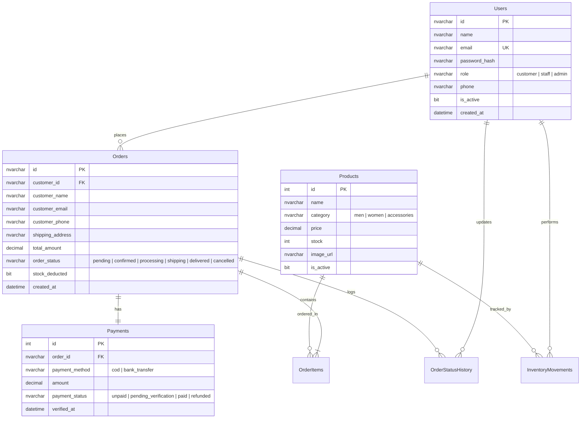

# Maison Rue — Luxury Fashion E-Commerce (3-Portal RBAC & MS SQL Server Backend)

Hệ thống thương mại điện tử thời trang cao cấp Maison Rue với kiến trúc **3 Cổng riêng biệt (Three Distinct Portals)**: **CUSTOMER PORTAL**, **STAFF PORTAL**, và **ADMIN PORTAL**, kết nối tập trung vào một cơ sở dữ liệu **Microsoft SQL Server (`MaisonRueDB`)** thông qua backend bảo mật **Node.js / Express**.

---

## 1. Kiến Trúc 3 Cổng Riêng Biệt (Three Distinct Portals)

Maison Rue được thiết kế với sự phân lập hoàn toàn về giao diện, tuyến đường, thẩm quyền đăng nhập và cơ chế bảo vệ:

| Thuộc tính | Customer Portal | Staff Portal | Admin Portal |
| :--- | :--- | :--- | :--- |
| **Đăng nhập** | `/login` | `/staff/login` | `/admin/login` |
| **Đích đến sau đăng nhập** | `/account/orders` | `/staff` | `/admin` |
| **Layout** | Luxury Storefront (Header, Banner, Chatbot, Footer) | Operational Workspace (Sidebar, Bảng kiểm soát đơn, Kho) | Executive Workspace (Sidebar, Báo cáo tài chính, Nhân sự) |
| **Đăng ký tài khoản** | **Công khai** (Tab Đăng ký tại `/login`) | **Đóng** (Chỉ Admin tạo tài khoản nhân viên) | **Đóng** (Không đăng ký công khai) |
| **Chức năng chính** | Xem catalog, giỏ hàng, đặt hàng, theo dõi đơn, hủy đơn | Xử lý quy trình đơn hàng 5 bước, quản lý tồn kho, nhập/xuất kho | Báo cáo doanh thu đã thu (Paid), KPIs thực tế, quản lý tài khoản Staff |

---

## 2. Tài Khoản Thử Nghiệm Phát Triển (Development Accounts)

Các mật khẩu được băm an toàn bằng **bcrypt** (10 rounds) và lưu trữ trong cơ sở dữ liệu Microsoft SQL Server:

| Vai trò | Email đăng nhập | Mật khẩu | Cổng đăng nhập hợp lệ | Thẩm quyền & Hành vi |
| :--- | :--- | :--- | :--- | :--- |
| **Admin** | `admin@maisonrue.com` | `admin123` | `/admin/login` | Truy cập `/admin`, `/admin/employees`, `/admin/reports`, `/admin/orders`. Bị chặn nếu đăng nhập ở `/login` hoặc `/staff/login`. |
| **Staff** | `staff@maisonrue.com` | `staff123` | `/staff/login` | Truy cập `/staff`, `/staff/orders`, `/staff/inventory`. Bị chặn nếu đăng nhập ở `/admin/login` hoặc `/login`. |
| **Staff 2** | `staff2@maisonrue.com` | `staff123` | `/staff/login` | Nhân viên vận hành số 2 kiểm tra đồng bộ phiên làm việc. |
| **Staff (Khóa)** | `staff.inactive@maisonrue.com` | `staff123` | `/staff/login` | Bị backend từ chối đăng nhập với thông báo *"Tài khoản đã bị vô hiệu hóa"*. |
| **Customer** | `customer@gmail.com` | `customer123` | `/login` | Mua sắm, thanh toán, quản lý đơn cá nhân. Bị chặn nếu truy cập Staff hoặc Admin. |

> **Nguyên tắc từ chối đăng nhập đa cổng (Strict Role Rejection):**
> Backend xác thực kép cả thông tin đăng nhập và vai trò cổng truy cập. Khách hàng hoặc Nhân viên cố ý đăng nhập qua `/admin/login` sẽ bị backend từ chối ngay lập tức với mã lỗi HTTP 403 Forbidden.

---

## 3. Hướng Dẫn Cài Đặt & Khởi Chạy Dự Án

### Yêu cầu môi trường
- **Node.js** >= 18.0.0
- **Cơ sở dữ liệu Microsoft SQL Server**: Có thể dùng 1 trong 2 cách:
  - **Cách 1 (Khuyên dùng - Nhanh nhất):** Dùng Docker Desktop để chạy MSSQL container chỉ với 1 lệnh (`npm run docker:up`).
  - **Cách 2:** Cài đặt trực tiếp Microsoft SQL Server (Developer/Express) trên Windows với cổng 1433.

### Bước 1: Khởi động Microsoft SQL Server bằng Docker (Nếu dùng Docker)
Nếu máy bạn có Docker Desktop, chỉ cần chạy:
```bash
npm run docker:up
```
> Lệnh này sẽ kéo image Microsoft SQL Server 2022 và khởi động container `maisonrue-mssql` với cổng 1433, dữ liệu được lưu bền vững vào volume `maisonrue_mssql_data`.

### Bước 2: Cài đặt thư viện dependencies
```bash
npm install
```

### Bước 3: Cấu hình biến môi trường (`.env`)
Sao chép tệp mẫu; `.env` thật không được đưa lên Git:

```powershell
Copy-Item .env.example .env
```

Nếu dùng Docker ở Bước 1, tệp mẫu đã cấu hình sẵn mật khẩu `MaisonRue@2026!` khớp hoàn toàn với container. Nếu dùng SQL Server cục bộ, điền mật khẩu `DB_PASSWORD` của máy bạn:
```env
PORT=5000
NODE_ENV=development
CLIENT_ORIGIN=http://localhost:5173
JWT_SECRET=replace_with_a_long_random_secret
DB_SERVER=127.0.0.1
DB_PORT=1433
DB_NAME=MaisonRueDB
DB_USER=sa
DB_PASSWORD=MaisonRue@2026!
DB_TRUST_SERVER_CERTIFICATE=true
```

Các biến Google Maps, Resend (email backend) và chatbot là tùy chọn. Khi chưa cấu hình, website vẫn
chạy được nhưng những tích hợp bên ngoài tương ứng sẽ được bỏ qua.

### Bước 4: Khởi tạo toàn bộ dữ liệu dự án (chạy một lần trên máy mới)
```bash
# Tạo schema, migration, catalog, tồn kho, giá vốn, đơn phân tích 90 ngày
# và một chiến dịch/mã ưu đãi mẫu có thể tái tạo trên mọi máy
npm run setup
```

Lệnh `setup` là quy trình chuẩn khi clone/pull dự án sang máy mới. Lệnh này tạo
`MaisonRueDB` nếu chưa tồn tại, áp dụng toàn bộ migration, đồng bộ catalog/SKU và
nạp dữ liệu demo phục vụ báo cáo. Tài khoản SQL Server phải có quyền tạo database.
Tồn kho nằm trong MSSQL cục bộ và không được Git truyền sang máy khác. `setup` tái tạo bộ
dữ liệu demo canonical từ mã nguồn (catalog, SKU, đơn phân tích, chỉ số, mẫu đợt sale,
chiến dịch "Maison Rue Seasonal Edit" và mã `RUE10`). Không chạy riêng
`db:replace-catalog` để sửa tồn kho; lệnh này chỉ đồng bộ catalog và luôn giữ nguyên
tồn kho của SKU đã tồn tại.

> Git không nên chứa file `.bak`, file MDF/LDF hay `.env`: các file này vừa nặng, phụ thuộc
> máy chủ SQL Server, vừa có thể lộ mật khẩu. Cách chia sẻ dữ liệu đúng là migration + seed
> có thể lặp lại và có kiểm tra sau khi chạy.

Nếu database demo cục bộ đã bị thay đổi nhiều và cần đưa về **đúng bộ dữ liệu chuẩn**,
hãy dừng backend trước rồi dùng lệnh phá hủy dữ liệu sau (chỉ dành cho database demo):
```powershell
$env:CONFIRM_DEMO_RESET='MAISON_RUE'
npm run db:reset-demo
```

### Bước 4: Kiểm thử toàn diện hệ thống (38 test cases tự động)
```bash
npm test
```

### Bước 5: Khởi chạy Backend và Frontend
Lệnh phát triển khởi chạy cả backend API (port 5000) và frontend React/Vite (port 5173):
```bash
npm run dev
```

Để chỉ khởi chạy backend API, dùng `npm run server` trong một cửa sổ Terminal riêng.

Mở trình duyệt truy cập:
- **Customer Storefront:** `http://localhost:5173`
- **Customer Login:** `http://localhost:5173/login`
- **Staff Portal Login:** `http://localhost:5173/staff/login`
- **Admin Portal Login:** `http://localhost:5173/admin/login`

### Sau khi pull code mới

Git chỉ đồng bộ mã nguồn và ảnh đã commit, không đồng bộ dữ liệu bên trong SQL Server của từng máy.
Sau khi pull, hãy dừng hoàn toàn tiến trình `npm run dev` cũ rồi chạy:

```bash
npm install
npm run setup
npm run doctor
npm run dev
```

`npm run doctor` phải hiển thị Database: OK và số lượng Products, Orders, Units sold.
Sau `setup`, chạy thêm `npm run db:verify-demo` để kiểm tra catalog, KPI, mẫu sale,
chương trình khuyến mãi và mã ưu đãi đều hiện diện. Các script của dự án ưu tiên `.env`
trong thư mục dự án để không bị một biến môi trường Windows `DB_PORT` cũ làm kết nối nhầm
database; mặc định cổng là `1433`.
Nếu giao diện mới nhưng API trả 404, backend cũ vẫn đang chạy hoặc Terminal đang đứng ở repository/nhánh khác.
Kiểm tra `http://localhost:5000/api/health`: backend đúng phải trả `apiVersion` và danh sách `capabilities`.

### Các lệnh bổ sung cho Database:
```bash
# Chỉ dùng khi phát triển từng phần; cài máy mới nên dùng npm run setup
npm run db:migrate

# Nạp dữ liệu tài khoản và sản phẩm mẫu vào SQL Server
npm run db:seed

# Phân bổ lại dữ liệu tồn kho demo theo bốn trạng thái vận hành
npm run db:seed-metrics

# Chuẩn hóa tuổi tồn, ngày ra mắt, nhãn Classic/Best seller và hành vi yêu thích
# để phần đề xuất khuyến mãi có dữ liệu thực tế, có thể chạy lại an toàn
npm run db:normalize-promotions

# Chỉ đồng bộ bốn tài khoản demo, không thay đổi catalog/đơn hàng/tồn kho
npm run db:accounts
```

---

## 4. Cơ Sở Dữ Liệu Microsoft SQL Server (`MaisonRueDB`)

Schema DDL được thiết kế chuẩn mực quan hệ (3NF) trong [`server/db/schema.sql`](./server/db/schema.sql):



### Tính toàn vẹn nghiệp vụ (Business Rules & ACID Transactions):
1. **Checkout & Stock Deduction:** Khi khách hàng đặt đơn, backend chạy **SQL Transaction**: kiểm tra số lượng tồn kho từng mặt hàng, trừ kho, tạo bản ghi `Orders`, `OrderItems`, `Payments` (`payment_status = 'unpaid'`), và ghi nhật ký vào `InventoryMovements`.
2. **Order Cancellation & Stock Restoration:** Khi đơn bị hủy, SQL Transaction hoàn trả tồn kho về trạng thái ban đầu, cập nhật `Orders.stock_deducted = 0`, ghi nhật ký hoàn kho `order_cancellation_restore`, và cập nhật `Payments.payment_status = 'refunded'`.
3. **Revenue Accounting (Doanh thu thực tế):** Chỉ các đơn có `Payments.payment_status = 'paid'` (được kích hoạt khi đơn hàng chuyển sang `delivered`) mới được tính vào doanh thu thực thu của doanh nghiệp. Các đơn đang luân chuyển được tính vào mục *Doanh thu đang xử lý*. Không có tình trạng tính trùng lặp doanh thu (Anti Double-Counting).

---

## 5. Danh Mục Tuyến Đường & Phân Quyền (Route Hierarchy)

### Cổng Khách Hàng (Customer Portal)
- `/` — Trang chủ thương hiệu thời trang Maison Rue
- `/men`, `/women`, `/accessories` — Danh mục sản phẩm
- `/product/:id` — Chi tiết sản phẩm & tình trạng tồn kho thời gian thực
- `/cart` — Giỏ hàng
- `/checkout` — Thanh toán & tạo đơn hàng
- `/login` — Đăng nhập & Đăng ký tài khoản Khách hàng
- `/account/orders` — **[Bảo vệ - Customer]** Xem lịch sử đơn, tiến trình 5 bước, chi tiết thanh toán, hủy đơn

### Cổng Nhân Viên (Staff Portal Workspace)
- `/staff/login` — Trang đăng nhập bảo mật dành riêng cho Staff
- `/staff` — **[Bảo vệ - Staff]** Dashboard vận hành: đơn chờ duyệt, cảnh báo kho hết hàng/sắp hết hàng
- `/staff/orders` — **[Bảo vệ - Staff]** Xử lý quy trình đơn hàng: Pending ➔ Confirmed ➔ Processing ➔ Shipping ➔ Delivered
- `/staff/inventory` — **[Bảo vệ - Staff]** Quản lý kho: điều chỉnh số lượng tồn, xem lịch sử biến động nhập/xuất kho (Inventory Movements)

### Cổng Quản Trị (Admin Portal Workspace)
- `/admin/login` — Trang đăng nhập bảo mật dành riêng cho Admin
- `/admin` — **[Bảo vệ - Admin]** Dashboard điều hành: Doanh thu thực nhận, AOV, phân bổ đơn hàng, cơ cấu doanh số danh mục
- `/admin/employees` — **[Bảo vệ - Admin]** Quản lý nhân viên: xem danh sách, tạo tài khoản Staff mới, cập nhật thông tin, kích hoạt/vô hiệu hóa tài khoản nhân sự
- `/admin/reports` — **[Bảo vệ - Admin]** Báo cáo tài chính & doanh thu đối soát: lọc theo kỳ, xuất file báo cáo kiểm toán CSV
- `/admin/orders` — **[Bảo vệ - Admin]** Giám sát đơn hàng & tình trạng thanh toán toàn diện

### Tuyến đường hệ thống
- `/access-denied` — Trang từ chối quyền truy cập với giao diện sang trọng chuẩn Maison Rue và nút chuyển hướng về cổng tương ứng.

---

## 6. Danh Mục API Backend (RESTful Endpoints)

| Phương thức | Tuyến đường API | Thẩm quyền | Mô tả chức năng |
| :--- | :--- | :--- | :--- |
| `POST` | `/api/auth/customer/login` | Public | Đăng nhập cổng Khách hàng, cấp HttpOnly Cookie |
| `POST` | `/api/auth/staff/login` | Public | Đăng nhập cổng Nhân viên, kiểm tra `is_active` |
| `POST` | `/api/auth/admin/login` | Public | Đăng nhập cổng Quản trị viên |
| `POST` | `/api/auth/register` | Public | Đăng ký tài khoản khách hàng mới |
| `POST` | `/api/auth/logout` | Authenticated | Xóa cookie phiên làm việc |
| `GET` | `/api/auth/me` | Authenticated | Lấy thông tin user hiện tại từ token cookie |
| `GET` | `/api/products` | Public | Lấy danh mục sản phẩm & tồn kho hiện hành |
| `PATCH` | `/api/products/:id/stock` | Staff, Admin | Cập nhật số lượng tồn kho & ghi lịch sử movement |
| `GET` | `/api/products/inventory/movements`| Staff, Admin | Xem lịch sử biến động nhập/xuất kho |
| `GET` | `/api/orders` | Authenticated | Lấy danh sách đơn hàng (Customer xem đơn của mình, Staff/Admin xem toàn bộ) |
| `POST` | `/api/orders` | Authenticated / Public | Tạo đơn hàng mới bằng SQL Transaction |
| `PATCH` | `/api/orders/:id/status` | Staff, Admin | Chuyển đổi trạng thái đơn hàng theo workflow hợp lệ |
| `POST` | `/api/orders/:id/cancel` | Customer, Staff | Hủy đơn hàng và tự động hoàn trả tồn kho |
| `GET` | `/api/admin/employees` | Admin | Lấy danh sách tài khoản nhân viên Staff |
| `POST` | `/api/admin/employees` | Admin | Tạo mới tài khoản nhân viên Staff |
| `PUT` | `/api/admin/employees/:id` | Admin | Cập nhật thông tin nhân viên Staff |
| `PATCH` | `/api/admin/employees/:id/status` | Admin | Bật/tắt trạng thái hoạt động của nhân viên |
| `GET` | `/api/admin/reports/revenue` | Admin | Báo cáo doanh thu thực nhận dựa trên `payment_status = 'paid'` |
| `GET` | `/api/health` | Public | Kiểm tra trạng thái hoạt động backend & kết nối DB |

---

## 7. Dữ liệu được chia sẻ và dữ liệu cục bộ

- Git chứa mã nguồn, migration SQL, catalog, SKU và toàn bộ ảnh WebP cần cho giao diện.
- Git không chứa `.env`, mật khẩu SQL Server, JWT secret, khóa API, `node_modules`,
  `dist`, hoặc database MSSQL của từng máy.
- Tài khoản trong mục 2 chỉ là dữ liệu demo phát triển; không dùng cho production.
- Sau khi pull thay đổi catalog, chạy `npm run setup` trên database demo mới. Với
  database đang có dữ liệu nghiệp vụ cần giữ, chỉ chạy migration/sync phù hợp và sao
  lưu trước khi thay đổi dữ liệu.

---

## 8. Giữ Gìn Bản Sắc Thương Hiệu (Brand Identity)
- Màu sắc chủ đạo: Nền kem `#F8F5F0`, chữ nâu cà phê đậm `#2B211C`, điểm nhấn vàng kim `#B89B5E`.
- Typography: Tiêu đề Cormorant Garamond cổ điển sang trọng kết hợp thân bài Inter hiện đại sắc nét.
- Giữ catalog hiện hành, bộ lọc danh mục, trợ lý thời trang Rue và luồng email Resend phía backend tùy chọn.
