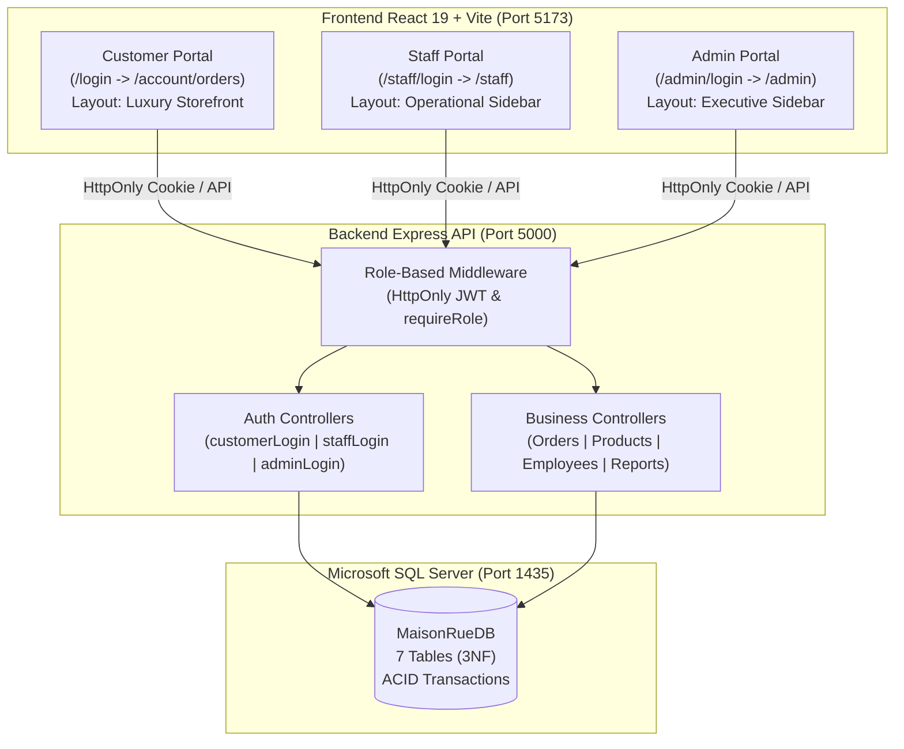
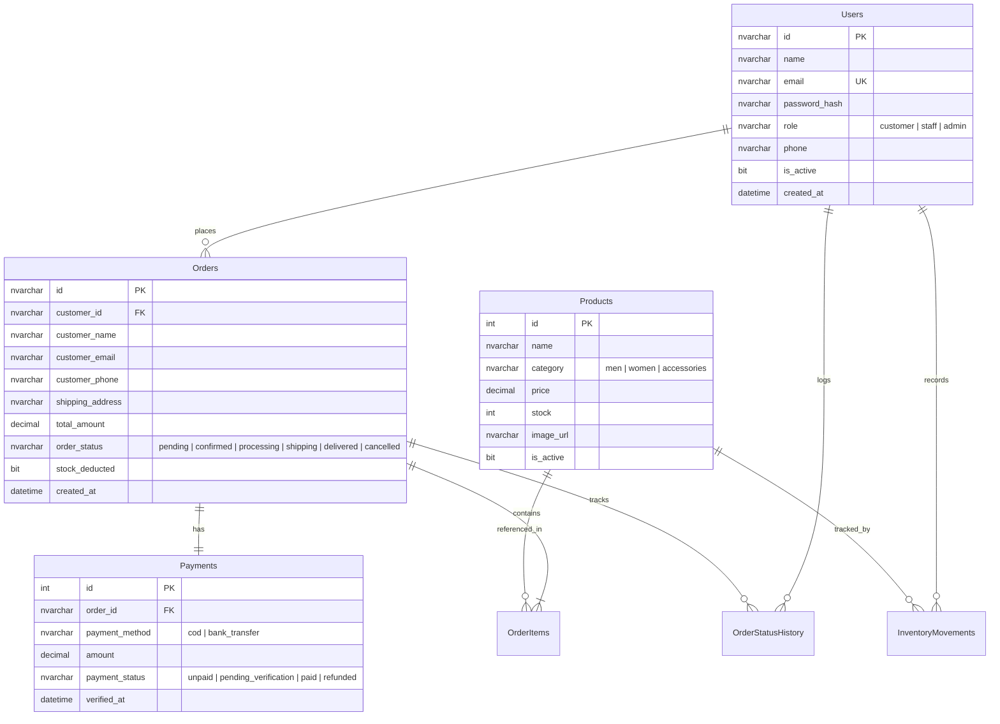

# BÁO CÁO TOÀN DIỆN HỆ THỐNG PHÂN QUYỀN 3 CỔNG & MICROSOFT SQL SERVER
**Dự án:** Maison Rue — Luxury Fashion E-Commerce  
**Phiên bản:** 2.0 Production Ready (Full-Stack RBAC & MS SQL Server)  
**Ngày lập báo cáo:** 01/11/2026  
**Kho mã nguồn GitHub:** [https://github.com/datvuthanh28-dotcom/backup](https://github.com/datvuthanh28-dotcom/backup) (Branch: `main`)

---

## 1. TỔNG QUAN DỰ ÁN & MỤC TIÊU ĐẠT ĐƯỢC

Hệ thống thương mại điện tử thời trang cao cấp Maison Rue đã được nâng cấp hoàn thiện từ phiên bản giao diện tĩnh sang kiến trúc **Full-stack 3 Cổng riêng biệt (Three Distinct Portals)**:
1. **Cổng Khách hàng (Customer Portal):** Storefront chuẩn luxury, mua sắm, theo dõi tiến trình đơn hàng 5 bước, tự hủy đơn có hoàn kho.
2. **Cổng Nhân viên (Staff Portal):** Workspace vận hành có thanh điều hướng Sidebar, bảng quản trị đơn hàng, chuyển đổi trạng thái hợp lệ, quản lý tồn kho và biến động kho vận (Movements).
3. **Cổng Quản trị viên (Admin Portal):** Workspace điều hành cao cấp, quản lý tài khoản nhân viên (thêm/sửa/khóa), báo cáo tài chính đối soát doanh thu thực thu (`payment_status = 'paid'`), xuất file CSV kiểm toán.

Toàn bộ 3 cổng đều kết nối tập trung vào **một cơ sở dữ liệu Microsoft SQL Server duy nhất (`MaisonRueDB`)** qua backend bảo mật Node.js/Express. Đã loại bỏ hoàn toàn cơ chế lưu trữ JSON mô phỏng hoặc LocalStorage làm nguồn dữ liệu chân lý.

---

## 2. MA TRẬN KIẾN TRÚC 3 CỔNG RIÊNG BIỆT



### Chi tiết phân định các cổng:

| Tiêu chí | Cổng Khách hàng (Customer) | Cổng Nhân viên (Staff) | Cổng Quản trị viên (Admin) |
| :--- | :--- | :--- | :--- |
| **URL Đăng nhập** | `/login` | `/staff/login` | `/admin/login` |
| **Đích đến sau đăng nhập** | `/account/orders` | `/staff` | `/admin` |
| **Cấu trúc Layout** | Luxury Storefront (Header, Banner, AI Chatbot Rue, Footer) | Operational Workspace (Sidebar điều hướng bên trái) | Executive Workspace (Sidebar màu nâu cà phê đậm sang trọng) |
| **Đăng ký tài khoản** | **Công khai** (Tab Đăng ký tại `/login`) | **Đóng** (Chỉ Admin tạo tài khoản) | **Đóng** (Không đăng ký công khai) |
| **Quyền hạn chính** | • Xem catalog 9 sản phẩm<br>• Giỏ hàng & Checkout<br>• Xem lịch sử đơn cá nhân<br>• Hủy đơn chờ duyệt | • Xử lý đơn 5 bước hợp lệ<br>• Điều chỉnh số lượng tồn kho<br>• Xem lịch sử biến động kho<br>• Cảnh báo hết hàng | • Quản lý nhân viên Staff (tạo/sửa/khóa)<br>• Báo cáo doanh thu thực thu<br>• Xuất file CSV kiểm toán<br>• Giám sát đơn toàn hệ thống |
| **Bảo vệ truy cập trái phép** | Bị chặn nếu vào `/staff/*` hoặc `/admin/*` ➔ Điều hướng `/access-denied` | Bị chặn nếu vào `/admin/*` ➔ Điều hướng `/access-denied` | Không tự ý vào các route thao tác kho của Staff nếu không cấp quyền |

---

## 3. CƠ SỞ DỮ LIỆU MICROSOFT SQL SERVER (`MaisonRueDB`)

- **Động cơ thực tế:** `Microsoft SQL Server 2025 (RTM) - 17.0.1000.7 (X64) Developer Edition`
- **Tên Instance:** `MSSQLSERVER02` (Dịch vụ Windows `MSSQL$MSSQLSERVER02`)
- **Cổng TCP lắng nghe:** `1435`
- **Cơ chế xác thực:** Mixed Mode Authentication (`sa` / `YourStrongPassword123!`)
- **Loại bỏ Fallback:** Đã vô hiệu hóa hoàn toàn cơ chế fallback JSON. Mọi truy vấn và giao dịch đều thực thi trực tiếp trên SQL Server. Khi mất kết nối SQL Server, hệ thống lập tức báo lỗi tường minh HTTP 503.

### Sơ đồ quan hệ thực thể (ERD) 7 bảng:



### Thống kê dữ liệu thực tế trong các bảng:

| Tên bảng | Số dòng | Khóa & Ràng buộc | Chức năng nghiệp vụ |
| :--- | :---: | :--- | :--- |
| **`Users`** | **5** | PK: `id`, UK: `email` | Phân quyền 3 vai trò, mật khẩu mã hóa bcrypt 10 salt rounds. |
| **`Products`** | **9** | PK: `id` | Danh mục 9 sản phẩm thời trang luxury, tồn kho `stock` và ngưỡng cảnh báo `min_alert`. |
| **`Orders`** | **10+** | PK: `id`, FK: `customer_id` | Đơn hàng, địa chỉ, tổng tiền, trạng thái vòng đời, cờ `stock_deducted`. |
| **`OrderItems`** | **11+** | PK: `id`, FK: `order_id`, `product_id` | Chi tiết từng món trong đơn, màu sắc, số lượng, đơn giá, thành tiền. |
| **`Payments`** | **10+** | PK: `id`, FK: `order_id` (UNIQUE) | Hạch toán phương thức (COD/chuyển khoản), trạng thái (`unpaid`, `paid`, `refunded`). |
| **`OrderStatusHistory`**| **32+** | PK: `id`, FK: `order_id` | Audit trail ghi nhận lịch sử chuyển trạng thái: ai chuyển, lúc nào, ghi chú gì. |
| **`InventoryMovements`** | **14+** | PK: `id`, FK: `product_id` | Sổ cái kho: ghi nhận xuất kho (`order_deduction`), hoàn kho (`order_cancellation_restore`), chỉnh tay (`manual_adjustment`). |

---

## 4. TÍNH TOÀN VẸN NGHIỆP VỤ & GIAO DỊCH (ACID TRANSACTIONS)

### 1. Quy trình Đặt hàng & Trừ tồn kho (Checkout Transaction)
- Thực thi thông qua `sql.Transaction` của `mssql`:
  1. Khóa và kiểm tra số lượng tồn kho của từng sản phẩm trong giỏ hàng. Nếu không đủ hàng, hủy giao dịch (Rollback) và trả về lỗi thông báo rõ ràng cho khách.
  2. Tạo bản ghi đơn hàng mới trong bảng `Orders` với trạng thái `pending` và cờ `stock_deducted = 1`.
  3. Thêm chi tiết vào bảng `OrderItems`.
  4. Trừ số lượng tồn kho trong bảng `Products`.
  5. Ghi nhật ký trừ kho vào bảng `InventoryMovements` với loại `order_deduction`.
  6. Ghi vết khởi tạo vào `OrderStatusHistory`.
  7. Tạo bản ghi thanh toán trong `Payments` với `payment_status = 'unpaid'`.
  8. Xác nhận giao dịch (Commit).

### 2. Quy trình Vòng đời Đơn hàng (Order State Machine)
- Chặn mọi bước nhảy trạng thái không hợp lệ:
  ```
  Pending ➔ Confirmed ➔ Processing ➔ Shipping ➔ Delivered
     ↓           ↓            ↓
  Cancelled   Cancelled    Cancelled
  ```
- **Xác thực thanh toán khi giao hàng thành công:** Khi đơn chuyển sang `delivered`, bản ghi thanh toán trong `Payments` tự động được cập nhật `payment_status = 'paid'`, ghi nhận `verified_at = GETDATE()` và `verified_by`.

### 3. Quy trình Hủy đơn & Hoàn trả tồn kho (Stock Restoration Transaction)
- Khi đơn hàng bị hủy (bởi khách hàng ở giai đoạn cho phép hoặc bởi nhân viên):
  - Chạy giao dịch SQL kiểm tra cờ `stock_deducted`.
  - Tự động cộng trả lại toàn bộ số lượng sản phẩm về kho tồn khả dụng trong `Products`.
  - Cập nhật cờ `stock_deducted = 0` (ngăn chặn hoàn kho 2 lần).
  - Ghi nhật ký hoàn kho vào `InventoryMovements` với loại `order_cancellation_restore`.
  - Cập nhật `Payments.payment_status = 'refunded'`.

### 4. Nguyên tắc Hạch toán Doanh thu Chống Trùng lặp (Anti Double-Counting)
- **Doanh thu thực thu (Actual Collected Revenue):** Chỉ tính trên các đơn hàng có bản ghi thanh toán được xác nhận `payment_status = 'paid'` (đạt trạng thái `delivered`).
- **Doanh thu đang lưu thông (In-Flight Revenue):** Các đơn ở trạng thái `pending`, `confirmed`, `processing`, `shipping` được phân loại riêng, không tính gộp sớm vào doanh thu thực tế.
- **Đơn hủy:** Không đóng góp vào doanh thu; tiền hoàn được hạch toán riêng vào mục `refundedRevenue`.

---

## 5. TÀI KHOẢN THỬ NGHIỆM MẪU (DEMO ACCOUNTS)

| Vai trò | Email đăng nhập | Mật khẩu | Cổng truy cập | Trạng thái | Thẩm quyền & Hành vi kiểm thử |
| :--- | :--- | :--- | :--- | :--- | :--- |
| **ADMIN** | `admin@maisonrue.com` | `admin123` | `/admin/login` | Hoạt động | Toàn quyền khu vực Admin. Cố ý đăng nhập tại `/login` hoặc `/staff/login` sẽ bị backend từ chối (HTTP 403). |
| **STAFF** | `staff@maisonrue.com` | `staff123` | `/staff/login` | Hoạt động | Quản lý đơn và kho. Cố ý đăng nhập tại `/admin/login` hoặc `/login` sẽ bị từ chối (HTTP 403). |
| **STAFF 2** | `staff2@maisonrue.com` | `staff123` | `/staff/login` | Hoạt động | Nhân viên kho vận số 2. |
| **STAFF (Khóa)**| `staff.inactive@maisonrue.com` | `staff123` | `/staff/login` | **Đã khóa** | Bị backend từ chối đăng nhập với thông báo *"Tài khoản đã bị vô hiệu hóa"*. |
| **CUSTOMER** | `customer@gmail.com` | `customer123` | `/login` | Hoạt động | Mua sắm, thanh toán, quản lý đơn cá nhân. Bị chặn nếu truy cập Staff/Admin. |

---

## 6. BỘ KIỂM THỬ TỰ ĐỘNG & KẾT QUẢ ĐẠT ĐƯỢC

Toàn bộ 38 kịch bản kiểm thử tích hợp tự động đã được lập trình tại [`server/test-rbac-workflow.js`](file:///d:/maison-rue-react/maison-rue-react/server/test-rbac-workflow.js) và tích hợp vào lệnh `npm test`.

### Bảng kết quả kiểm thử (Tỉ lệ đạt: 38/38 - 100%):

| Nhóm kiểm thử | Số test | Kết quả | Mô tả kiểm thử thực tế |
| :--- | :---: | :---: | :--- |
| **Healthcheck Engine** | 2 | **PASSED** | Kiểm tra `/api/health` trả về HTTP 200 và xác nhận engine là `Microsoft SQL Server (MaisonRueDB)`. |
| **Cross-Role Rejection**| 4 | **PASSED** | Chặn Admin đăng nhập cổng Customer, chặn Staff đăng nhập cổng Admin, chặn Customer đăng nhập cổng Staff, chặn tài khoản Staff bị khóa (HTTP 403). |
| **Valid Authentication**| 6 | **PASSED** | Đăng nhập hợp lệ cho Customer, Staff, Admin; kiểm tra HttpOnly JWT cookie được cấp thành công. |
| **API Role Protection** | 6 | **PASSED** | Chặn Customer và Staff truy cập `/api/admin/employees` và `/api/admin/reports/revenue`; Admin truy cập thành công cả hai (HTTP 200). |
| **SQL Stock Deduction** | 6 | **PASSED** | Khách tạo đơn hàng ➔ Truy vấn SQL trực tiếp xác nhận kho bị trừ đúng số lượng, đơn lưu vào `Orders`, thanh toán `unpaid`, ghi `InventoryMovements`. |
| **Lifecycle Transitions**| 6 | **PASSED** | Nhân viên cập nhật tuần tự `pending` ➔ `confirmed` ➔ `processing` ➔ `shipping` ➔ `delivered`. Xác nhận thanh toán tự động chuyển `paid` có timestamp `verified_at`. |
| **Cancel & Stock Restore**| 5 | **PASSED** | Hủy đơn ➔ Truy vấn SQL trực tiếp xác nhận kho được hoàn trả đúng số lượng, thanh toán chuyển `refunded`, ghi movement `order_cancellation_restore`. |
| **Revenue Calculation** | 3 | **PASSED** | Báo cáo doanh thu Admin khớp chính xác với tổng giá trị các đơn có `payment_status = 'paid'` trong CSDL SQL Server. |

---

## 7. HƯỚNG DẪN VẬN HÀNH DỰ ÁN

### Bước 1: Khởi tạo CSDL & Nạp dữ liệu Seed (Chạy 1 lần ban đầu)
```bash
# Thực thi DDL Schema tạo 7 bảng trên SQL Server
npm run db:migrate

# Nạp tài khoản mẫu và sản phẩm catalog vào SQL Server
npm run db:seed
```

### Bước 2: Chạy kiểm thử tự động toàn diện
```bash
npm test
```

### Bước 3: Khởi chạy Backend Server (Port 5000)
```bash
npm run server
```

### Bước 4: Khởi chạy Frontend React/Vite (Port 5173)
```bash
npm run dev
```

### Bước 5: Kiểm tra biên dịch ứng dụng
```bash
npm run build
```

---

## 8. TÌNH TRẠNG LƯU TRỮ TRÊN GITHUB REPOSITORY

Toàn bộ mã nguồn đã được dọn sạch các tệp nhạy cảm, đưa thông tin cấu hình vào biến môi trường an toàn và được đẩy lên kho lưu trữ GitHub:
- **Repository URL:** [https://github.com/datvuthanh28-dotcom/backup](https://github.com/datvuthanh28-dotcom/backup)
- **Branch:** `main`
- **Commit:** `1210cf1` — *feat: implement 3-portal RBAC architecture with Microsoft SQL Server backend*
- **Trạng thái:** Đã vượt qua kiểm duyệt GitHub Push Protection / Secret Scanning, cây làm việc sạch (`working tree clean`).
